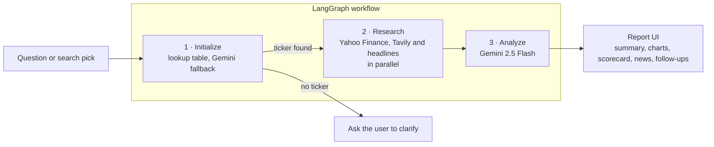

<div align="center">

# 📈 Agentic Finance Analyst

### An AI research terminal for US and Indian stocks, built on a three-agent LangGraph workflow

Ask about a company in plain English. Agents identify the ticker, gather market data and news in parallel,
and Gemini writes a clear report with a Bullish / Neutral / Bearish verdict. Prices, ratios, charts, the
scorecard and the signals are computed from real data, and anything missing says so instead of being guessed.

[](https://YOUR-APP-NAME.streamlit.app)


[Live demo](https://YOUR-APP-NAME.streamlit.app) · [Screenshots](#screenshots) · [Features](#features) ·
[How it works](#how-it-works) · [Quick start](#quick-start) · [Deploy](#deploy-to-streamlit-community-cloud) ·
[Limitations](#known-limitations)

<br>


</div>

> ⚠️ **Educational research only. This is not financial advice.** AI output can be wrong, and market data can
> be delayed or incomplete. Check primary sources before making any decision.

**At a glance:** 3 agents · 7-check explainable scorecard · 5 market indices · about 50 catalog stocks ·
US and Indian (NSE/BSE) listings · line, candlestick and interactive 3D charts · a 3D globe with 12 exchange hubs

---

## Why this project is different

Most AI finance demos let the model say anything. This one is built around a simple rule: **the AI writes the
story, the data supplies the numbers, and the page always shows which is which.**

- **No fabricated data.** A missing value is shown as `N/A`, an empty section says so, and the scorecard never
  counts missing data as zero.
- **Freshness is visible.** Each report shows when its snapshot was taken, the last trade time, and how old
  the fundamentals are.
- **One consistent snapshot.** The summary card, signals and the AI text all read the same price snapshot, and
  P/E is labelled trailing or forward everywhere.
- **Explainable scoring.** Every scorecard point shows its rule and the value behind it.
- **Honest failures.** Yahoo Finance throttles sometimes. The app shows a notice with a retry button, keeps the
  last good chart data (clearly marked as saved), and never invents a number.

### What is AI-written, and what is not

| Piece of the page | Where it comes from | AI-written? |
|---|---|---|
| Price, daily change, 52-week range, trailing P/E | Yahoo Finance snapshot captured during the analysis | No |
| Market cap, forward P/E, margins, growth, ROE, analyst view | Yahoo Finance company profile | No |
| Charts and returns | Yahoo Finance daily closes | No |
| Scorecard, bullish / bearish / risk signals | Fixed rules applied to the numbers above | No |
| News list with source links | Yahoo Finance headlines | No |
| Report text and the Bullish / Neutral / Bearish verdict | Gemini, from the data above plus a Tavily news search | **Yes** |
| "Bottom line" sentence in the summary card | Extracted from the AI report | **Yes** |
| Follow-up answers | Gemini, from this report's saved data only | **Yes** |

---

## Screenshots

| Research report | Stock comparison |
|---|---|
|  |  |

| Interactive 3D chart |
|---|
|  |

<!-- Optional: add docs/overview.png and uncomment the next two lines
| Market overview |
|  | -->

---

## Features

### Research

| | |
|---|---|
| 🤖 **Three-agent workflow** | Identify the ticker, research in parallel, then analyze with Gemini, orchestrated by LangGraph |
| 🧾 **Compact report** | A summary card (price, verdict gauge, five key stats) followed by collapsible sections, so a long conversation stays short |
| 🧮 **Explainable scorecard** | Seven transparent checks, each with its rule and value. Missing data is N/A, and no score is shown with fewer than three usable checks |
| ⚖️ **Signals and risks** | Bullish, bearish and risk factors computed from real numbers, with unusual figures flagged for verification |
| 📰 **News with sources** | Headlines with publisher, age and links. Only headlines that name the company are given to the AI analyst |
| 💬 **Follow-up questions** | Ask up to five questions per report. Answers use only the report's saved data, and decline price predictions and personal buy/sell advice |
| 📄 **Report export** | Download a standalone HTML report and save it as a PDF from your browser, or download Markdown |

### Exploration

| | |
|---|---|
| 🔍 **Smart search** | Company logos, names, tickers and exchanges, from a built-in catalog plus Yahoo Finance search. Picking a result starts the full workflow |
| 📊 **Charts** | Line and candlestick views with volume, a 20-day average and 1M / 3M / 6M / 1Y ranges, plus an interactive 3D explorer |
| 🆚 **Stock comparison** | Two or three stocks side by side with a rebased performance chart, a metrics table and scorecards |
| 🌐 **Market overview** | Market pulse, five indices with trend charts, top movers and a sector heatmap, with an All / US / India filter |
| 📌 **Watchlist and recent research** | Logos and daily price changes, with one-click re-analysis |
| 📈 **Live ticker tape** | Scrolling indices and popular stocks |

### Experience

| | |
|---|---|
| 🌍 **3D market globe** | Reacts to the agents: it spins up while they research, turns to the stock's exchange, and takes the verdict colour. Orbit rings, capital-flow arcs and light trails |
| 🧊 **Glass UI** | Manrope and Inter typography, cyan / blue / violet accents, responsive layout |
| ⚡ **Performance mode** | One switch turns off the globe, blur effects and typing animation for slower machines. The globe also lowers its own detail if the frame rate drops |
| ♿ **Reduced motion** | Respects the operating system's reduced-motion setting |

---

## How it works



| Agent | Job | Details |
|---|---|---|
| **1 · Initialize** | Find the ticker | Tries free options first: an explicit `(TICKER)` in the message (what search and catalog clicks send), then a built-in company table matched on whole words. Gemini is only asked if both miss |
| **2 · Research** | Gather evidence | Runs Yahoo Finance metrics (with NSE/BSE suffix fallback and a retry), a Tavily news search and Yahoo headlines at the same time. Headlines that don't name the company are dropped |
| **3 · Analyze** | Write the report | Gemini receives today's date and strict rules: older items are background, not recent news, conflicting news loses to the verified metrics, and thin coverage must be said plainly |

Everything after the analysis (charts, scorecard, signals, comparison, overview) is computed in Python from
Yahoo Finance data.

<details>
<summary><b>Scorecard rules</b> (every report shows these next to each value)</summary>

| Check | Metric | 2 points | 1 point | 0 points |
|---|---|---|---|---|
| Valuation | Forward P/E | ≤ 20 | ≤ 35 | higher |
| Profitability | Profit margin | ≥ 20% | ≥ 8% | lower |
| Growth | Revenue growth (YoY) | ≥ 10% | ≥ 0% | shrinking |
| Efficiency | Return on equity | ≥ 15% | ≥ 8% | lower |
| Momentum | 6-month price change | ≥ +10% | ≥ −5% | lower |
| Analyst view | Yahoo consensus, 5+ analysts | Buy | Hold | Sell |
| Volatility | Beta | ≤ 1.0 | ≤ 1.5 | higher |

A score needs at least three usable checks. 70% or more reads "Strong", 45% or more "Mixed", below that
"Weak". The thresholds are generic and ignore industry norms (banks and software companies are valued
differently), so treat the score as a transparent snapshot, not a prediction.

</details>

---

## Quick start

**You need:** Python 3.13 or newer (developed on 3.13, also runs on 3.14), a
[Google AI Studio](https://aistudio.google.com) API key and a [Tavily](https://tavily.com) API key.

```bash
# 1. get the code
git clone https://github.com/ayush-yadav314/financial-agent-ai.git
cd financial-agent-ai

# 2. create and activate a virtual environment
python -m venv venv
venv\Scripts\activate            # Windows
# source venv/bin/activate       # macOS / Linux

# 3. install the pinned dependencies
pip install -r requirements.txt
```

**4. Add your keys.** Create a file named `.env` in the project folder:

```
GOOGLE_API_KEY=your_google_api_key_here
TAVILY_API_KEY=your_tavily_api_key_here
```

**5. Run it.**

```bash
streamlit run app.py
```

Open http://localhost:8501. Never commit your `.env` file: it is already listed in `.gitignore`.

Optional health check after editing anything in `ui/`:

```bash
python check_ui.py
```

It verifies that `app.py` and every `ui/` module import and call each other correctly.

## Configuration

| Setting | Purpose |
|---|---|
| `GOOGLE_API_KEY` | Gemini API key (required) |
| `TAVILY_API_KEY` | Tavily search key (required) |
| `FIN_PERSIST=1` | Opt in to remembering the watchlist and recent research between runs (saved to `data/user_state.json`). **Off by default**, because that file would be shared by everyone using the same server |
| `FIN_DATA_DIR` | Folder for the saved state (default: `data/`) |
| Sidebar: Performance mode | Turns off the globe, blur effects and typing animation |

## Deploy to Streamlit Community Cloud

1. Push the repository to GitHub.
2. On [share.streamlit.io](https://share.streamlit.io) create a new app, choose the repository, and set the
   main file to `app.py`.
3. Open the app's **Settings → Secrets** and add your keys as **top-level** entries (above any `[section]`):

   ```toml
   GOOGLE_API_KEY = "your_google_api_key_here"
   TAVILY_API_KEY = "your_tavily_api_key_here"
   ```

   Top-level secrets are also exposed as environment variables, which is how the app reads them.
4. Saving the watchlist is off by default, so a public deployment needs no extra setting.

**Good to know:** every Secrets change or redeploy restarts the app. Yahoo Finance sometimes throttles the
shared servers that free hosting runs on, so prices and fundamentals can show `N/A` for a while after a
restart. The app says so instead of guessing, and clicking **↻ Retry** or **⟳ Refresh data** helps once the
limit lifts. The dependency versions are pinned in `requirements.txt` on purpose: the 3D scene depends on a
Streamlit feature that newer versions deprecate.

---

## Project structure

```
app.py                  Streamlit app: layout, chat flow, report assembly
agent.py                LangGraph agents: initialize -> research -> analyze
check_ui.py             Import and signature checker for app.py and ui/
requirements.txt        Pinned dependencies
.streamlit/config.toml  Theme colours
docs/                   README screenshots

ui/
  theme.py              Fonts, colours, glass styling, animations
  background.py         3D globe (Three.js) and its scene modes
  components.py         Hero, agent pipeline tracker, ticker tape
  report.py             Summary card and report sections
  chart3d.py            Interactive 3D candlestick explorer
  search.py             Smart search            catalog.py     Built-in stock catalog
  logos.py              Company logos           landing.py     Landing screen
  compare.py            Stock comparison        scorecard.py   Rule-based scorecard
  overview.py           Market overview         followup.py    Follow-up questions
  sidebar.py            Watchlist and history   store.py       Opt-in saved state
  data.py               Profile and news        prices.py      Price history
  market.py             Ticker tape data        export.py      HTML / PDF report export
  polish.py             Performance mode, mobile layout, globe masking
  motion.py             Smooth scroll, typing placeholder
  inject.py             Hidden script injection (one place to change)
```

## Tech stack

| Area | Tools |
|---|---|
| Agents and AI | LangGraph, LangChain, Google Gemini 2.5 Flash, Tavily |
| Data | Yahoo Finance through `yfinance`, pandas |
| App and charts | Streamlit, Plotly, Three.js (3D globe and 3D chart) |
| Typography | Manrope and Inter |

Exact versions are pinned in `requirements.txt`.

---

## Reliability and security

- **Failures are contained.** A failed data request is never cached and is not retried in a tight loop. It
  shows a visible notice with a retry button, and charts keep the last good data, marked as saved.
- **Your analysis is never lost to a display error.** Answers are stored before they are drawn, and a broken
  section falls back to the plain AI text.
- **Caching.** Fundamentals for 15 minutes, price history, news and search for 10 minutes, ticker tape and
  market overview for 5 minutes. Repeated identical questions replay from an in-session cache without a new
  AI request.
- **Safe rendering.** All dynamic text is HTML-escaped, only `http(s)` links are shown, and tickers are
  validated before use.
- **Secrets stay out of git.** `.env` and local secrets are in `.gitignore`.
- **Saved state is opt-in.** The saved file is shared by everyone using the same server, so saving is off
  unless you turn it on.

## Known limitations

- **Data comes from Yahoo Finance through the unofficial `yfinance` library.** It can be rate-limited, delayed
  or incomplete, especially on shared cloud hosting. A second, keyed data provider is on the roadmap.
- **Free-tier quotas apply** to Gemini and Tavily, and each analysis and each follow-up question uses AI
  requests. Visitors of a public deployment share the owner's quota.
- **US and Indian (NSE/BSE) listings only** (`$` and `₹`). Search and price labels are built for those two.
- **Movers, the sector heatmap and the market pulse cover only the built-in catalog** (about 50 stocks), not
  the whole market. Sector groups are a simple classification made for this app.
- **Every daily change compares a stock's latest session with the one before it**, so US and Indian stocks can
  come from different days. The date is shown on every row.
- **The pulse label is a plain count** of catalog stocks up versus down on one day. It is not a prediction.
- **The scorecard and signals use generic thresholds** that ignore industry norms.
- **Tickers with a hyphen (for example `BRK-B`)** work from search and catalog clicks, but may not be
  recognised when the AI has to guess a ticker from free text.
- **Company logos** come from Google's favicon service, with initials as a fallback. They are small icons, not
  official brand assets.
- **The 3D features need WebGL** and rely on `st.components.v1.html`, which Streamlit has deprecated. The app
  still works without the 3D layer (Performance mode).

<details>
<summary><b>Troubleshooting</b></summary>

| Problem | What to do |
|---|---|
| `ModuleNotFoundError: No module named 'ui'` | Run from the project root and make sure `ui/__init__.py` exists |
| `ImportError` or `TypeError` naming a `ui/` function | A file is out of date. Run `python check_ui.py` to find which one |
| `StreamlitDuplicateElementKey` | The same widget is created twice, usually from an old copy of a `ui/` file. `check_ui.py` flags the common cause |
| Gemini error mentioning `429` or `RESOURCE_EXHAUSTED` | The free daily quota is used up. Wait, or enable billing in Google AI Studio |
| Prices or fundamentals show `N/A`, or "Price chart unavailable" | Yahoo Finance is throttling. Click **↻ Retry** or **⟳ Refresh data** and try again in a few minutes |
| No news in the report | Yahoo returned none for that stock right now. A link to Yahoo's news page is shown |
| Globe missing | Hard-refresh (`Ctrl+Shift+R`), check that WebGL is enabled, or switch Performance mode off |
| App feels slow | Turn on **Performance mode** in the sidebar |
| Watchlist is empty after a restart | Saving is off by default. Set `FIN_PERSIST=1` in your local `.env` |

</details>

<details>
<summary><b>FAQ</b></summary>

**Is this financial advice?** No. It is an educational project. The AI report includes a verdict and a
recommendation section, but it can be wrong, so use it as a starting point for your own research.

**Why does it show `N/A`?** Because the data source returned nothing for that field. The app prefers an
honest `N/A` over a guess.

**What does the AI actually see?** The verified Yahoo Finance metrics, a Tavily news summary, and Yahoo
headlines that name the company. Follow-up questions see only the saved report data.

**Why only US and Indian stocks?** Price formatting, search and the market overview are built for `$` and `₹`.
More exchanges are on the roadmap.

</details>

---

## Roadmap

- [x] Three-agent research workflow with a compact, collapsible report
- [x] Explainable scorecard, signals and follow-up questions
- [x] Stock comparison and market overview (pulse, indices, movers, heatmap)
- [x] Report export (HTML, print to PDF)
- [ ] Show price and 52-week range from chart data when Yahoo's quote endpoint is throttled
- [ ] A second, keyed market-data provider as a fallback
- [ ] Move the Tavily integration to `langchain-tavily` (the current class is deprecated upstream)
- [ ] Replace the deprecated `components.html` script injection once `st.iframe` is verified for it
- [ ] Automated tests for scoring, formatting and search ranking
- [ ] More exchanges and currencies
- [ ] Per-user storage for hosted deployments

## Contributing

Issues and pull requests are welcome. Before opening one, run `python check_ui.py` and try the app with one US
stock and one Indian stock.

## Disclaimer

This project is for educational and informational purposes only. It does not provide investment, financial,
legal or tax advice, and its authors are not responsible for decisions made using its output.

## Acknowledgements

[Yahoo Finance](https://finance.yahoo.com) data through [yfinance](https://github.com/ranaroussi/yfinance) ·
[Tavily](https://tavily.com) · [Google Gemini](https://ai.google.dev) ·
[LangGraph](https://github.com/langchain-ai/langgraph) · [Streamlit](https://streamlit.io) ·
[Plotly](https://plotly.com) · [Three.js](https://threejs.org)

## License

No open-source license has been chosen yet, so by default all rights are reserved. Add a `LICENSE` file (for
example MIT) to allow reuse.

<div align="center">

Built by [@ayush-yadav314](https://github.com/ayush-yadav314)

</div>