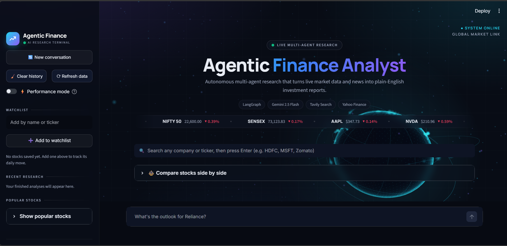
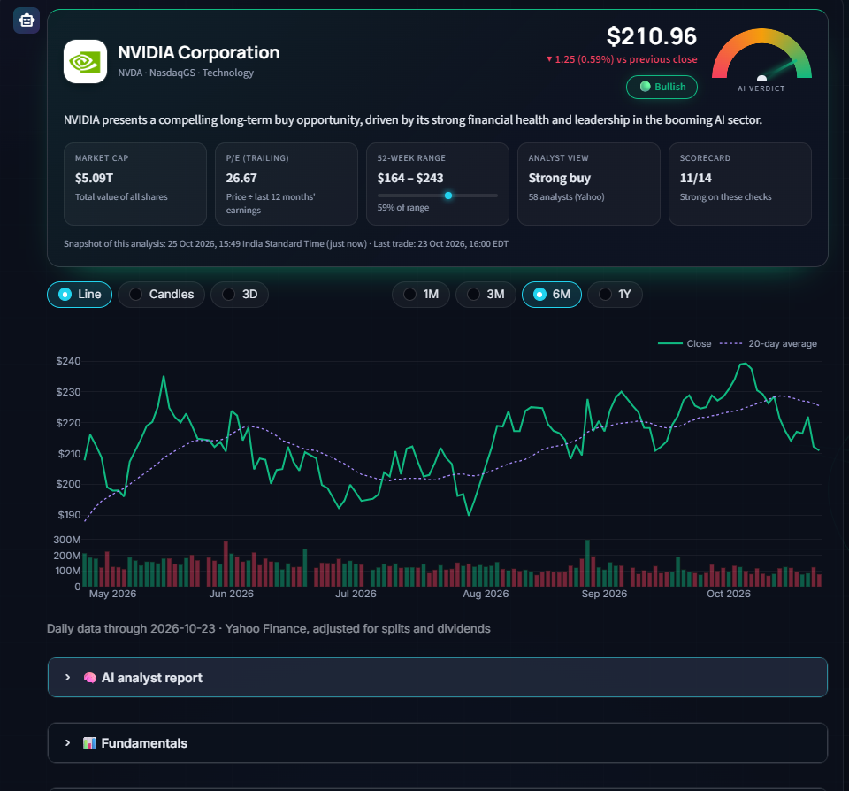
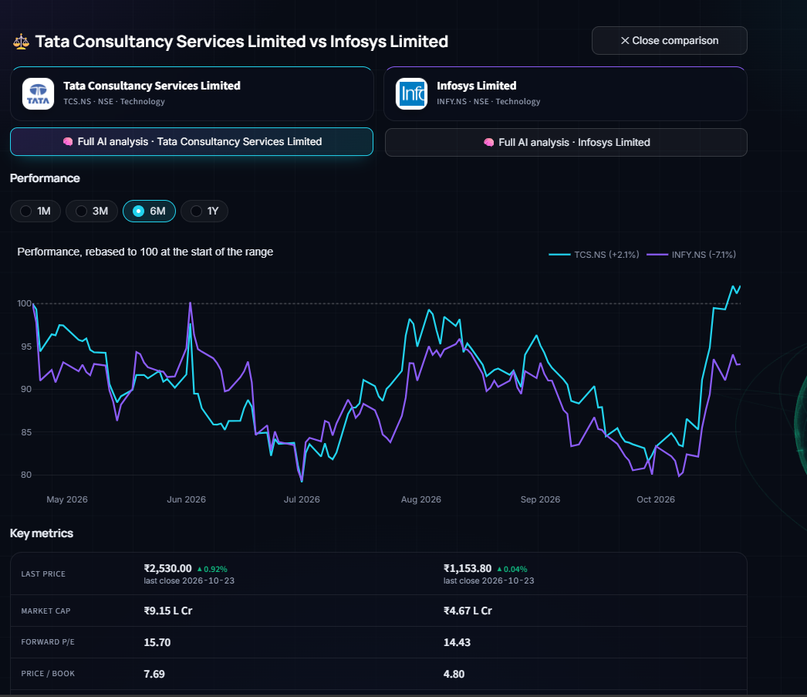
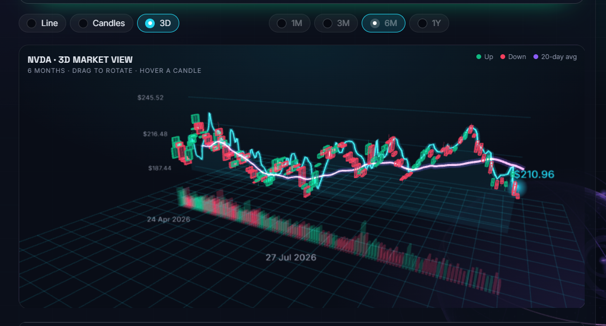
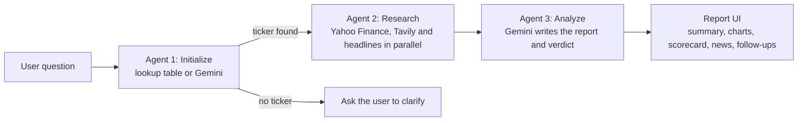

<div align="center">

# 📈 Agentic Finance Analyst

**An AI-powered stock research terminal.** Ask about a company in plain English and a three-agent
workflow gathers live market data and news, then writes a clear research report with a
Bullish / Neutral / Bearish verdict.


</div>

> ⚠️ **Educational research only. This is not financial advice.** AI output can be wrong, and market
> data can be delayed or incomplete. Always check primary sources before making any decision.

---

## Contents

[Screenshots](#screenshots) · [Features](#features) · [How it works](#how-it-works) · [Quick start](#quick-start) ·
[Configuration](#configuration) · [Project structure](#project-structure) · [Reliability](#reliability-and-data-honesty) ·
[Limitations](#limitations) · [Troubleshooting](#troubleshooting) · [Roadmap](#roadmap) · [Contributing](#contributing)

---

## Screenshots

| Landing page | Research report |
|---|---|
|  |  |

| Stock comparison | 3D chart |
|---|---|
|  |  |

---

## Features

### Research
| | |
|---|---|
| 🤖 **Three-agent workflow** | Identify the ticker, research in parallel (Yahoo Finance, Tavily search and Yahoo headlines), then analyze with Gemini |
| 🧾 **Compact report** | A summary card (price, verdict gauge, key stats) followed by collapsible sections: AI report, fundamentals, signals and risks, scorecard, company overview, news and sources |
| 🧮 **Explainable scorecard** | Seven transparent rule-based checks, each with its rule and value shown. Missing data is N/A, never counted as zero |
| ⚖️ **Signals and risks** | Bullish, bearish and risk factors computed from real numbers, with unusual figures flagged for verification |
| 💬 **Follow-up questions** | Answered only from the report's saved data (up to 5 per report). Declines price predictions and personal advice |
| 📰 **News with sources** | Headlines with publisher, time and links. Items that name the company are marked |

### Exploration
| | |
|---|---|
| 🔍 **Smart search** | Company logos, names, tickers and exchanges, from a built-in catalog plus Yahoo Finance search (US and Indian listings) |
| 📊 **Charts** | Line and candlestick views with a volume panel, 1M / 3M / 6M / 1Y ranges and an interactive 3D explorer |
| 🆚 **Stock comparison** | Two or three stocks side by side with a rebased performance chart, metrics table and scorecards |
| 📌 **Watchlist and history** | Logos and daily price changes, plus a recent-research list. Both are saved between sessions |
| 📈 **Market ticker tape** | Live scrolling indices and popular stocks |

### Experience
| | |
|---|---|
| 🌍 **3D market globe** | Animated globe that reacts to the agents and to the verdict, with orbit rings, capital-flow arcs and light trails |
| 🧊 **Glass UI** | Manrope and Inter typography, cyan / blue / violet accents, responsive layout |
| ⚡ **Performance mode** | One switch turns off the 3D globe, blur and typing animation for slower machines |
| ♿ **Reduced motion** | Respects the operating system's reduced-motion setting |

---

## How it works



- **Initialize** first tries a free lookup (an explicit `(TICKER)` in the message, or a built-in company table) before spending a Gemini request.
- **Research** fetches market metrics, a Tavily news summary and Yahoo headlines at the same time. Only headlines that actually name the company are given to the analyst.
- **Analyze** receives today's date and strict rules for treating old or conflicting news carefully.
- Everything after the analysis (charts, scorecard, signals) is computed from Yahoo Finance data, not generated by the AI.

---

## Quick start

**Requirements:** Python 3.10 or newer, a [Google AI Studio](https://aistudio.google.com) API key
and a [Tavily](https://tavily.com) API key. Developed on Python 3.13.

```bash
# 1. get the code
git clone https://github.com/ayush-yadav314/financial-agent-ai.git
cd financial-agent-ai

# 2. create and activate a virtual environment
python -m venv venv
venv\Scripts\activate            # Windows
# source venv/bin/activate       # macOS / Linux

# 3. install dependencies
pip install -r requirements.txt

# 4. add your keys
copy .env.example .env           # Windows   (macOS / Linux: cp .env.example .env)
# then open .env and fill in your real keys

# 5. run
streamlit run app.py
```

**Never commit your `.env` file.** It is listed in `.gitignore`.

Optional health check after changing any file in `ui/`:

```bash
python check_ui.py
```

It verifies that `app.py` and every `ui/` module import and call each other correctly.

---

## Configuration

| Setting | Purpose |
|---|---|
| `GOOGLE_API_KEY` | Gemini API key (required), set in `.env` |
| `TAVILY_API_KEY` | Tavily search key (required), set in `.env` |
| `FIN_PERSIST=0` | Disables saving the watchlist and recent research (recommended for any shared or public deployment) |
| `FIN_DATA_DIR` | Folder for the saved state (default: `data/`) |
| Sidebar → Performance mode | Turns off the globe, blur effects and typing animation |

---

## Project structure

```
app.py                 Streamlit app: layout, chat flow, report assembly
agent.py               LangGraph agents: initialize -> research -> analyze
check_ui.py            Import and signature checker for app.py and ui/
.streamlit/config.toml Theme colors

ui/
  theme.py             Fonts, colors, glass styling, animations
  background.py        3D globe (Three.js) and scene modes
  components.py        Hero, pipeline tracker, ticker tape
  report.py            Summary card and report sections
  chart3d.py           Interactive 3D candlestick explorer
  search.py            Smart search          catalog.py   Stock catalog
  logos.py             Company logos         landing.py   Landing screen
  compare.py           Stock comparison      scorecard.py Rule-based scorecard
  followup.py          Follow-up questions   sidebar.py   Watchlist and history
  data.py              Profile and news      prices.py    Price history
  market.py            Ticker tape data      store.py     Saved state
  polish.py            Performance mode, mobile layout, globe masking
  motion.py            Smooth scroll, typing placeholder
  inject.py            Hidden script injection (one place to change)
```

---

## Reliability and data honesty

- **No fabricated data.** A missing value is shown as `N/A`, an empty section says so, and the AI is instructed not to invent events.
- **Freshness is visible.** Each report shows when the analysis snapshot was taken, the last trade time, and how old the fundamentals are.
- **Consistent numbers.** The summary card, signals and AI analysis read the same price snapshot, and P/E is labelled trailing or forward everywhere.
- **Failures are contained.** A failed data request is never cached, is not retried in a tight loop, and shows a visible notice with a retry button. Charts keep the last good data (clearly marked as saved) during brief outages.
- **Your analysis is never lost to a display error.** Answers are saved before they are drawn.
- **Caching.** Fundamentals are cached for 15 minutes, price history and news for 10 minutes, and repeated identical questions replay from an in-session cache without a new AI request.

---

## Limitations

- Data comes from Yahoo Finance through the unofficial `yfinance` library. It can be rate-limited, delayed or incomplete.
- News search uses Tavily and the analysis uses Gemini. **Free-tier quotas apply**, and each analysis and each follow-up question uses AI requests.
- Search and price formatting support **US listings and Indian NSE/BSE listings** (`$` and `₹`) only.
- The scorecard and signals use generic thresholds and ignore industry norms. Banks and software companies are valued differently.
- Company logos come from Google's favicon service, with initials as a fallback. They are small icons, not official brand assets.
- The saved watchlist file is shared by everyone using the same server. This app is built for **single-user use**.
- `st.components.v1.html` is deprecated in newer Streamlit versions, and the 3D globe depends on it. Pin the Streamlit version in `requirements.txt` that works for you.
- The 3D features need WebGL. If it is unavailable, the app still works without them.

---

## Troubleshooting

| Problem | What to do |
|---|---|
| `ModuleNotFoundError: No module named 'ui'` | Run from the project root, and make sure `ui/__init__.py` exists |
| `ImportError` or `TypeError` naming a `ui/` function | A file is out of date. Run `python check_ui.py` to find which one |
| Gemini error mentioning `429` or `RESOURCE_EXHAUSTED` | The free daily quota is used up. Wait, or enable billing in Google AI Studio |
| "Price chart unavailable" or lots of `N/A` | Yahoo Finance is throttling. Click **↻ Retry** or **⟳ Refresh data**, and try again in a minute |
| No news in the report | Yahoo returned none for that stock right now. A link to Yahoo's news page is shown |
| Globe missing | Hard-refresh the browser (`Ctrl+Shift+R`), check that WebGL is enabled, or switch off Performance mode |
| App feels slow | Turn on **Performance mode** in the sidebar |

---

## Roadmap

- [ ] Fuller market overview panel (indices, movers, sectors)
- [ ] Automated tests for scoring and formatting logic
- [ ] Exporting reports as PDF
- [ ] Support for more exchanges and currencies
- [ ] Optional per-user storage for hosted deployments

---

## Contributing

Issues and pull requests are welcome. Before opening one, run `python check_ui.py` and test the
app with a US stock and an Indian stock.

## Disclaimer

This project is for educational and informational purposes only. It does not provide investment,
financial, legal or tax advice. The authors are not responsible for decisions made using its output.

## Acknowledgements

[Yahoo Finance](https://finance.yahoo.com) data via [yfinance](https://github.com/ranaroussi/yfinance) ·
[Tavily](https://tavily.com) · [Google Gemini](https://ai.google.dev) ·
[LangGraph](https://github.com/langchain-ai/langgraph) · [Streamlit](https://streamlit.io) ·
[Plotly](https://plotly.com) · [Three.js](https://threejs.org)

## License

No license has been chosen yet. Add a `LICENSE` file (for example MIT) before sharing the project widely.